# 대학생 과제 일정 관리 프로그램 API 업데이트 — ChatGPT 대화 기록

> 이 파일은 이 대화에서 보이는 사용자 메시지와 ChatGPT 답변을 순서대로 옮긴 기록입니다. **요약본이 아닙니다.** 사진으로 보내 주신 화면은 `api-chat-images/` 폴더에 원본 PNG로 포함했습니다. ChatGPT 서비스의 공식 데이터 내보내기 파일과는 다릅니다.

---

## 사용자

오늘(10/29) 수업에서 5주차 프로그램을 GitHub에 올리고, PR로 프로그램을 업데이트하는 방법을 알아보았습니다. 이번 과제는 실제 프로그램을 API를 적용하여 업데이트하는 것입니다.

과제 해야 하는데 필요한거 말하면 보낼게 과제 시작하자
작업은 Git branch에서 진행하고, Pull Request로 main에 합쳐서 제출합니다. Repository의 URL와 필요하다면 API key를 같이 제출합니다. 아예 새로 프로젝트를 진행하는 경우는 새 프로젝트 URL을 제출합니다.

다음 사항을 참고하시길 바랍니다.

- 기획안을 별도 api-plan.md 파일로 추가해서 repository에 업로드합니다.
- API에 Key가 필요한 경우 `.env`파일에 두고, README에 어떤 형식으로 키를 넣는지 설명합니다. 키는 별도로 icampus로 제출합니다.
- 모든 코드는 UV로 동작 환경의 재현이 가능해야 합니다.
- AI와 대화 내용 원문도 repository에 포함합니다.
- 코드 전반에 대한 설명은 README에 작성하되 3페이지 이내로 작성합니다.

제출 기한은 11/4(수) 자정입니다.

평가 항목 : 기획대로 작동하는가 (6점), 코드가 재현가능한가 (6점), Github repository 관리가 잘 되어있는가 (필요없는 파일, 지저분한 커밋 로그 등, 4점) 코드에 대한 이해가 충분한가 (README, 4점).

---

## ChatGPT

좋아요. 기존 5주차 프로그램을 바탕으로 API 기능을 추가하고, 별도 브랜치에서 작업한 뒤 PR로 `main`에 합치는 것까지 과제 기준에 맞춰 진행하겠습니다. 먼저 기존 코드와 프로그램 구조를 확인하겠습니다.

좋습니다! 이번 과제는 **20점 만점을 목표로**, 프로그램 구현부터 GitHub 제출까지 하나씩 진행해 봅시다.

먼저 지난번에 사용했던 GitHub 저장소를 확인했습니다.

[기존 GitHub 저장소 — hw_plan](https://github.com/koonskoons00-collab/hw_plan)

현재 저장소에는 다음 내용이 있습니다.

- `main.py`, `models.py`, `dialogs.py` : 대학생 과제 일정 관리 프로그램
- `wk5_2026313199` : 별도의 5주차 과제 폴더
- `API_PLAN.md` : 지난번에 작성한 곱셈표 API 기획안
- `pyproject.toml`, `uv.lock` : UV 관련 파일

그런데 **기존 `API_PLAN.md`는 곱셈표 프로그램을 설명하고 있고, 저장소 최상위의 `main.py`는 과제 일정 관리 프로그램**이라서 이번에 업데이트할 대상을 명확히 해야 합니다.

## 1. 이번 과제 진행 순서

1. **기존 프로그램 확인** — 어떤 프로그램을 업데이트할지 결정
2. **API 선정 및 기획** — `api-plan.md` 작성
3. **프로그램 업데이트** — 기존 기능 유지 + API 기능 추가
4. **실행 테스트** — `uv sync` 및 실행 확인
5. **제출 파일 정리** — README, AI 대화 원문, `.gitignore`
6. **GitHub 제출** — 새 브랜치 → Push → PR → main Merge

## 2. 지금 필요한 것

우선 **5주차 프로그램 폴더 전체를 ZIP 파일로 압축해서 보내주세요.** `.venv` 폴더는 제외해도 됩니다.

기존 GitHub 코드도 확인할 수 있지만, 원본 ZIP이 있으면 실제 파일 구조를 기준으로 수정하고 실행 여부까지 점검하기 좋습니다.

그리고 한 가지만 확인하겠습니다.

**이번에 API를 추가하고 싶은 프로그램은 무엇인가요?**

- 대학생 과제 일정 관리 프로그램 (달력, 과제 추가 및 마감일 관리)
- N×N 곱셈표 출력 프로그램
- 다른 프로그램 또는 아직 미정

오늘 **11월 4일(수) 자정 마감**이므로, API 키 발급이 복잡하지 않고 구현 및 설명이 쉬운 기능을 우선 고려하겠습니다.

파일을 보내주시면 먼저 기존 프로그램을 분석하고, **어떤 API를 추가하면 좋을지와 구체적인 구현 방법부터** 정하겠습니다.

---

## 사용자

대학생 과제 일정 관리 프로그램에 API를 추가하겠습니다.

---

## ChatGPT

과제 일정 관리 프로그램으로 진행하겠습니다. 과제 마감일과 연결되는 기능이 좋으니, 우선 **공휴일 API로 마감일과 휴일이 겹치는지 알려주는 기능**을 검토하겠습니다. 기존 코드 구조와 API 사용 조건을 확인해 보겠습니다.

---

## 사용자

진행상황이 필요하면 사진 보낼게

---

## ChatGPT

네! 진행하면서 확인이 필요한 부분이 생기면 화면 사진을 요청하겠습니다. **특히 PowerShell에서 오류가 발생하거나 GitHub에서 PR을 만드는 단계에서는 사진을 보내주시면 좋습니다.**

우선 기존 GitHub 저장소의 `main.py`를 확인했습니다. 현재 프로그램에는 달력, 과제 추가·수정·삭제, 마감 임박 알림 기능이 구현되어 있네요.

## 1. 추가할 API 기능

**공휴일 API를 이용한 과제 일정 관리 기능**을 추천합니다.

기존 달력에 공휴일을 표시하고, 과제 마감일이 공휴일과 겹치면 안내하는 기능입니다.

- 사용 API: [Nager.Date 공휴일 API](https://date.nager.at/)
- API Key: 필요 없음
- 기존 프로그램 기능은 그대로 유지
- API 연결이 실패하더라도 기존 과제 관리 기능은 사용 가능하도록 구현

공휴일 정보를 날짜와 국가 코드로 조회할 수 있어 기존 프로그램에 적용하기 좋습니다.

기존 소스의 구조를 확인했고, API는 공식 문서의 최신 **Nager.Holidays v4** 형식으로 적용하겠습니다. 과제 제출에 바로 사용할 수 있도록 수정 코드와 `api-plan.md`, `README.md`, UV 설정을 묶어 준비하겠습니다. GitHub에 올리기 전에는 기존 데이터 파일을 덮어쓰지 않도록 구분하겠습니다.

## 2. 업데이트 파일 준비 완료

**[공휴일 API 업데이트 파일 다운로드](hw_plan_공휴일API_업데이트.zip)**

ZIP · 수정 코드, 기획안, README, UV 설정, 테스트 파일 포함

최신 공식 API 주소인 `nagerholidays.com`의 v4 규격으로 작성했습니다.

Python 문법 검사와 API 데이터 처리 테스트 4개는 통과했습니다. 다만 실제 공휴일 서버 연결과 Windows 화면 동작은 아직 사용자 컴퓨터에서 확인해야 합니다.

## 3. 이제 GitHub 브랜치부터 확인하겠습니다

우선 기존 프로젝트 폴더에서 PowerShell을 열고 아래 두 명령어를 차례대로 실행해주세요.

```powershell
git status
git branch --show-current
```

**실행 결과 화면을 사진으로 보내주세요.** 현재 브랜치와 수정된 파일이 있는지 확인한 다음, 기존 작업을 보존하면서 새 브랜치 생성 → 파일 적용 → 실행 테스트 → PR 병합 순서로 안내하겠습니다.

GitHub 연결 기능도 사용할 수 있도록 제안해 두었습니다. 연결하면 저장소 작업을 더 직접적으로 진행할 수 있지만, 연결하지 않아도 PowerShell로 과제를 완성할 수 있습니다.

---

## 사용자

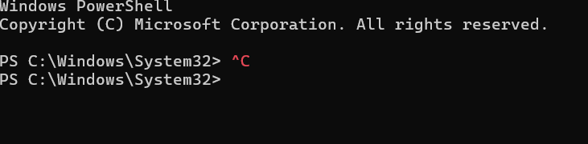

일단 cd..이런거 안하나요?

---

## ChatGPT

네, 맞습니다! 지금 PowerShell의 위치가 `C:\Windows\System32`이기 때문에 **먼저 과제 폴더로 이동해야 합니다.**

지난번에 과제를 바탕화면에서 진행했으니, 우선 바탕화면으로 이동하겠습니다.

### 1단계. 바탕화면으로 이동

PowerShell에 아래 코드를 복사해서 입력하세요.

```powershell
cd "$HOME\Desktop"
```

### 2단계. 바탕화면 폴더 확인

```powershell
dir
```

그러면 바탕화면에 있는 폴더 목록이 나타납니다.

**여기까지 실행한 화면을 사진으로 보내주세요.**

그다음 기존 GitHub 프로젝트 폴더로 들어가서 브랜치를 만들겠습니다.

참고로 `cd ..`은 상위 폴더로 한 단계 이동하는 명령어입니다. 지금은 `cd "$HOME\Desktop"`을 사용하면 여러 번 이동할 필요 없이 바로 바탕화면으로 갈 수 있습니다.

---

## 사용자

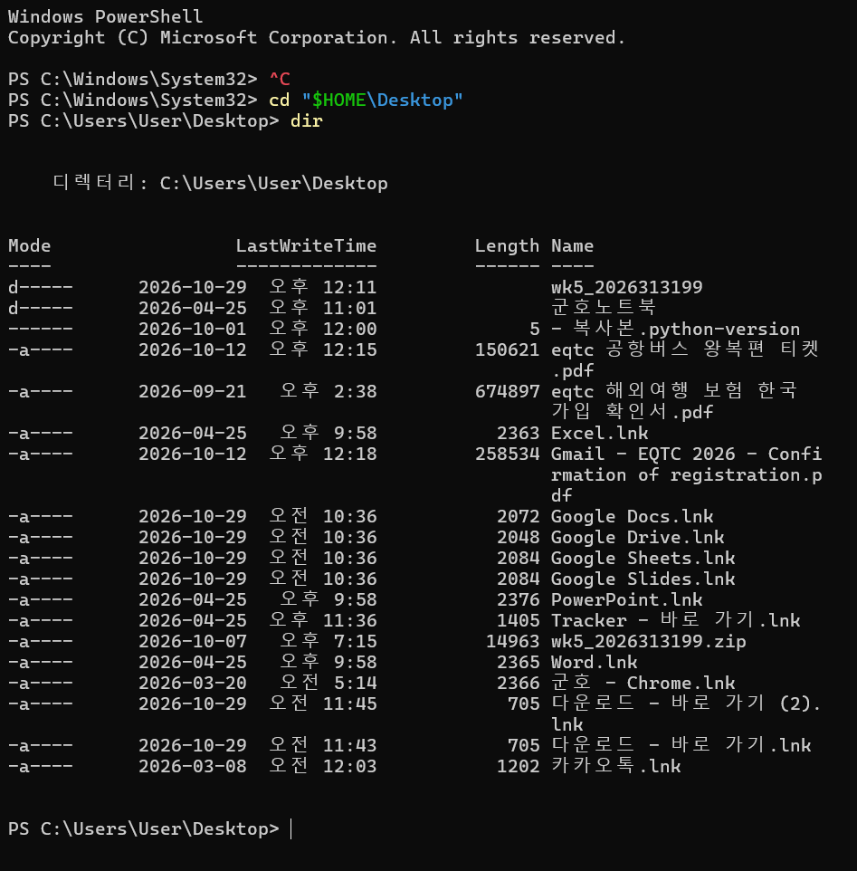

---

## ChatGPT

좋습니다! 바탕화면으로 정상적으로 이동했습니다.

사진을 확인하니 **`wk5_2026313199` 폴더**가 있네요.

이제 해당 폴더로 이동하겠습니다.

### 3단계. 과제 폴더로 이동

아래 명령어를 입력하세요.

```powershell
cd wk5_2026313199
```

### 4단계. GitHub 연결 상태 확인

이어서 아래 명령어를 순서대로 입력하세요.

```powershell
git status
```

```powershell
git branch
```

이 두 명령어로 기존 GitHub 저장소와 연결된 폴더인지, 현재 어떤 브랜치에 있는지 확인할 수 있습니다.

**여기까지 실행한 화면을 보내주세요.** 확인한 다음 새 브랜치를 만들고 API 업데이트를 진행하겠습니다.

---

## 사용자

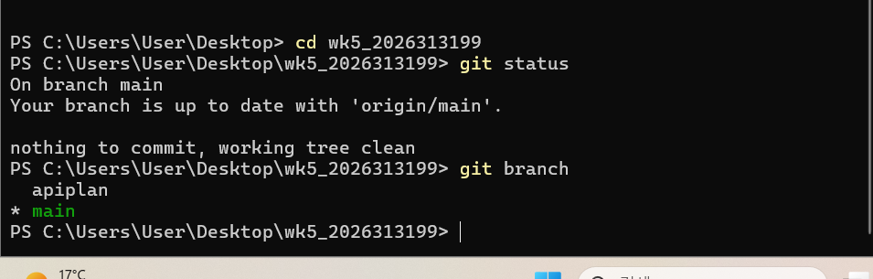

---

## ChatGPT

좋습니다! 사진을 확인했습니다. GitHub 연결 상태가 정상입니다.

현재 상태는 다음과 같습니다.

- 현재 브랜치: `main`
- 기존 브랜치: `apiplan`, `main`
- GitHub 원격 저장소와 동기화 완료
- 수정되거나 저장되지 않은 파일 없음 (`working tree clean`)

이제 **새로운 브랜치에서 API 업데이트 작업**을 시작하겠습니다.

### 5단계. 새로운 브랜치 만들기

지난번 `apiplan` 브랜치는 그대로 두고, 이번 과제용으로 `api-update` 브랜치를 새로 만들겠습니다.

PowerShell에 아래 명령어를 입력하세요.

```powershell
git switch -c api-update
```

성공하면 다음과 비슷하게 나타납니다.

```text
Switched to a new branch 'api-update'
```

이어서 현재 브랜치를 확인합니다.

```powershell
git branch
```

결과에 다음처럼 `api-update` 옆에 `*`가 표시되면 성공입니다.

```text
* api-update
  apiplan
  main
```

**여기까지 실행한 화면을 보내주세요.**

그다음 공휴일 API를 적용한 프로그램 파일을 넣고 실제로 실행해 보겠습니다.

---

## 사용자

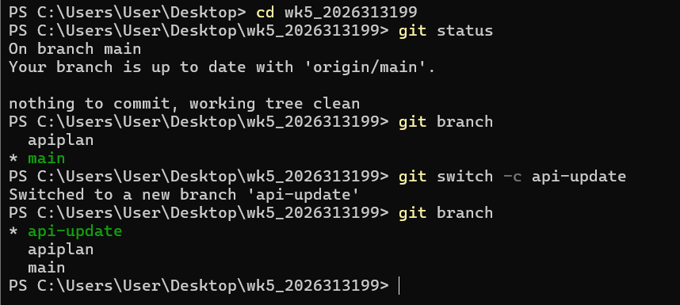

---

## ChatGPT

완벽합니다! 👍 새 브랜치 생성에 성공했습니다.

현재 상태는 다음과 같습니다.

- `main` : 기존 프로그램이 저장된 브랜치
- `apiplan` : 지난번에 만든 브랜치
- **`api-update` : 이번 API 과제를 진행할 브랜치 (현재 위치)**

이제 API 기능이 추가된 파일을 넣겠습니다.

## 6단계. API 업데이트 파일 적용하기

### ① ZIP 파일 다운로드

먼저 아래 파일을 다운로드하세요.

**[공휴일 API 업데이트 파일](hw_plan_공휴일API_업데이트.zip)**

### ② 압축 해제 및 파일 복사

1. 다운로드한 ZIP 파일을 마우스 오른쪽 버튼으로 클릭합니다.
2. **모두 압축 풀기**를 선택합니다.
3. 압축을 푼 폴더에서 `적용방법.txt`를 제외한 파일 8개를 복사합니다.
4. 바탕화면의 `wk5_2026313199` 폴더에 붙여넣습니다.
5. 같은 이름의 파일을 바꿀 것인지 물으면 **대상 폴더의 파일 덮어쓰기**를 선택합니다.

기존 `models.py`, `dialogs.py`, `assignments.json`, `conversation.md`는 삭제하거나 변경하지 마세요.

### ③ PowerShell에서 확인

복사가 끝나면 지금 열려 있는 PowerShell에 아래 명령어를 입력하세요.

```powershell
git status
```

그러면 변경된 파일과 새로 추가된 파일들이 표시될 것입니다.

**여기까지 실행한 화면을 보내주세요.**

다음 단계에서는 `uv sync`를 실행하고, 실제 프로그램에 공휴일 API가 정상적으로 적용되었는지 테스트하겠습니다.

---

## 사용자

공휴일 API 업데이트 파일 이 파일 다운로드가 안되

---

## ChatGPT

다운로드가 잘되도록 **파일 이름을 영어로 변경해서 다시 준비했습니다.** ZIP 파일도 정상적으로 열리는지 확인했습니다.

**[공휴일 API 업데이트 파일 다운로드](hw_plan_api_update.zip)**

`hw_plan_api_update.zip` · 11KB

링크를 클릭해서 다운로드해 보세요.

다운로드에 성공하면 압축을 풀어주세요. 기존 `wk5_2026313199` 폴더에 파일을 복사하는 단계부터 이어서 진행하겠습니다.

**이번에도 다운로드가 안 되면 알려주세요.** 파일 내용을 직접 복사해서 만들 수 있는 방법으로 진행하겠습니다.

---

## 사용자

압축 풀었어

---

## ChatGPT

좋습니다! 이제 압축을 푼 파일을 기존 과제 폴더에 넣겠습니다.

### 7단계. API 파일을 기존 프로젝트에 복사하기

**① 압축을 푼 폴더를 열어주세요.**

다음 8개 파일을 선택해서 복사(`Ctrl + C`)하세요.

- `main.py`
- `holiday_api.py`
- `test_holiday_api.py`
- `api-plan.md`
- `README.md`
- `pyproject.toml`
- `uv.lock`
- `.gitignore`

`적용방법.txt`는 복사하지 않아도 됩니다.

**② 기존 과제 폴더를 열어주세요.**

바탕화면 → `wk5_2026313199`

복사한 파일을 붙여넣기(`Ctrl + V`) 하세요.

같은 이름의 파일이 있다는 메시지가 나오면 **대상 폴더의 파일 덮어쓰기**를 선택하세요.

단, 기존 `models.py`, `dialogs.py`, `assignments.json`, `conversation.md`는 그대로 보존해야 합니다.

### 8단계. PowerShell에서 확인하기

기존에 열어둔 PowerShell에 다음 명령어를 입력하세요.

```powershell
git status
```

현재 브랜치는 앞에서 만든 `api-update`를 그대로 사용합니다. 새 브랜치를 다시 만들 필요는 없습니다.

**실행 결과를 사진으로 보내주세요.** 파일이 정상적으로 들어갔는지 확인한 뒤 `uv sync`로 실행 환경을 설정하겠습니다.

---
## 사용자

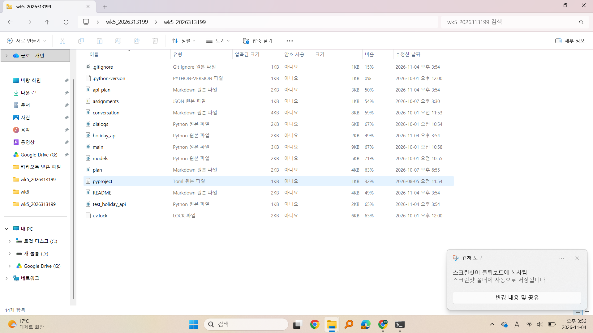

---

## ChatGPT

좋습니다! 사진을 확인했습니다. 파일 8개가 모두 보이네요.

다만 **지금은 압축을 푼 폴더가 아니라 ZIP 파일 내부를 보고 있는 상태**입니다. 화면에 `압축 풀기`, `압축된 크기` 등이 표시되어 있어요.

### 1단계. 압축 풀기

1. 화면 위쪽의 **압축 풀기**를 클릭하세요.
2. **모두 압축 풀기**를 선택하세요.
3. 압축이 풀린 폴더를 열어주세요.
4. 그 안에 있는 `wk5_2026313199` 폴더까지 들어가세요.

### 2단계. 파일 복사하기

다음 8개 파일을 선택해서 `Ctrl + C`를 누르세요.

- `main.py`
- `holiday_api.py`
- `test_holiday_api.py`
- `api-plan.md`
- `README.md`
- `pyproject.toml`
- `uv.lock`
- `.gitignore`

이제 **기존 GitHub 과제 폴더**로 이동합니다.

`C:\Users\User\Desktop\wk5_2026313199`

여기에 `Ctrl + V`로 붙여넣고 같은 이름의 파일은 덮어쓰세요.

주의: 폴더 전체를 넣지 말고 **파일 8개만 기존 폴더에 넣어야 합니다.** 기존 `models.py`, `dialogs.py`, `assignments.json`, `conversation.md`는 그대로 유지하세요.

### 3단계. GitHub에서 변경 확인

PowerShell에서 아래 명령어를 실행하세요.

```powershell
git status
```

**그 결과를 사진으로 보내주세요.** 변경된 파일을 확인하고 다음 단계인 `uv sync`로 넘어가겠습니다.

---

## 사용자

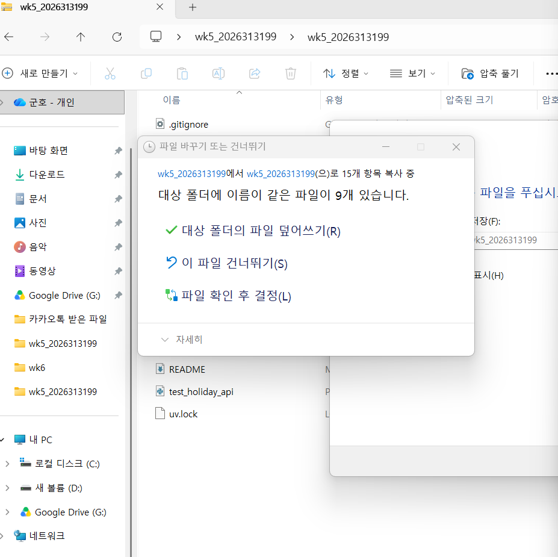

---

## ChatGPT

사진 확인했습니다! 거의 다 됐습니다. 😊

그런데 **한 가지 주의할 점이 있습니다.**

현재 화면에는 **15개 파일을 복사 중이고, 같은 이름의 파일이 9개 있다**고 나옵니다.

우리는 API 업데이트에 필요한 8개 파일만 복사하면 됩니다.

### 1단계. 현재 복사 취소하기

지금 창에서는 **'대상 폴더의 파일 덮어쓰기'를 누르지 마세요.**

오른쪽 위 `X`를 눌러 복사를 취소하세요.

### 2단계. 필요한 파일 8개만 복사하기

압축 해제한 폴더에서 `Ctrl` 키를 누른 상태로 다음 파일만 선택하세요.

- `main.py`
- `holiday_api.py`
- `test_holiday_api.py`
- `api-plan.md`
- `README.md`
- `pyproject.toml`
- `uv.lock`
- `.gitignore`

선택한 파일을 `Ctrl + C`로 복사한 뒤 기존 바탕화면의 `wk5_2026313199` 폴더에 붙여넣으세요.

이번에는 같은 이름의 파일이 나오면 **대상 폴더의 파일 덮어쓰기**를 선택해도 됩니다.

특히 `assignments.json`, `models.py`, `dialogs.py`, `conversation.md`는 기존 파일을 유지해야 합니다.

### 3단계. 확인하기

복사가 끝나면 PowerShell에서 실행하세요.

```powershell
git status
```

**결과 화면을 보내주세요!** 그러면 다음 단계인 프로그램 실행 테스트로 넘어가겠습니다.

---

## 사용자

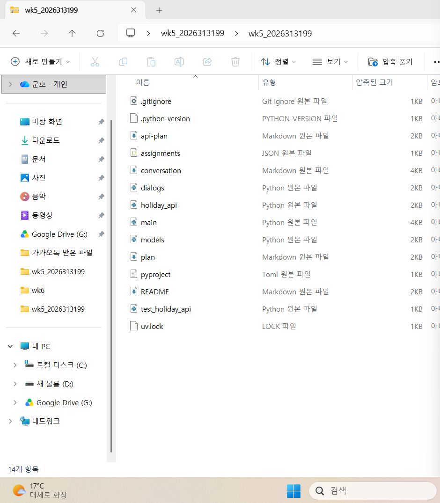

여기서 압축풀기하라고?

---

## ChatGPT

네, 맞습니다! 😊

지금 사진을 보니 **아직 ZIP 압축파일 내부에 있는 상태**입니다.

### 1단계. 압축 풀기

1. 화면 위쪽 오른쪽에 있는 **「압축 풀기」** 버튼을 클릭하세요.
2. **「모두 압축 풀기」**를 선택하세요.
3. 압축을 풀 위치가 나오면 기본 위치 그대로 두고 **「압축 풀기」**를 누르세요.

그러면 압축이 해제된 일반 폴더가 열립니다.

**여기까지만 진행하고 화면을 보내주세요.**

그다음 필요한 파일 8개만 선택해 기존 GitHub 과제 폴더로 옮기겠습니다.

---

## 사용자

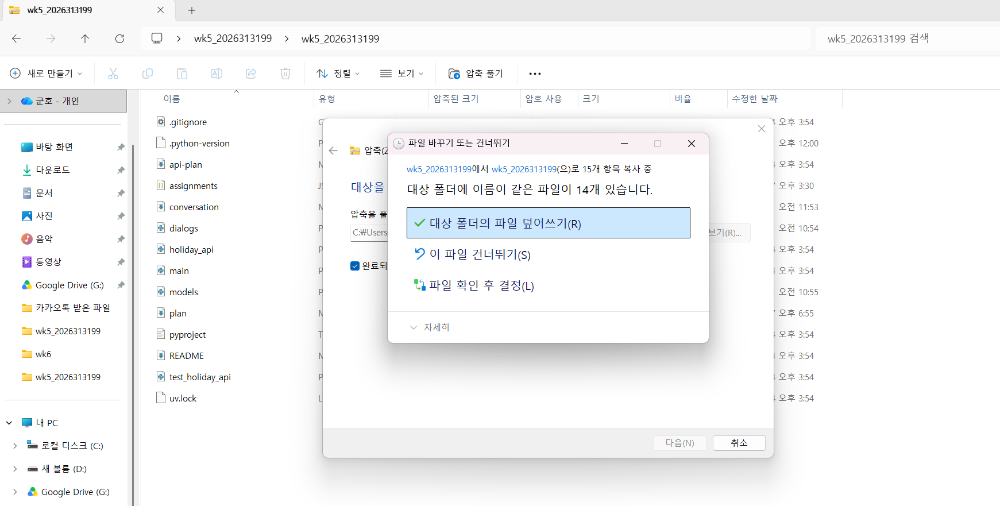

이 화면 뜨는데 뭐눌러

---

## ChatGPT

사진 확인했습니다! **지금은 「대상 폴더의 파일 덮어쓰기」를 누르지 마세요!**

기존 과제 파일 14개가 덮어써질 수 있기 때문입니다.

다음 순서대로 해주세요.

1. 지금 화면의 작은 창 오른쪽 위 **X**를 누르세요.
2. 뒤에 있는 「압축(ZIP) 폴더 풀기」 창에서 **「취소」**를 누르세요.

기존 과제 폴더와 다른 위치에 압축을 풀어야 합니다.

**우선 여기까지 하고 화면을 보내주세요.** 그다음 안전하게 압축을 풀 위치를 알려드리겠습니다.

---

## 사용자

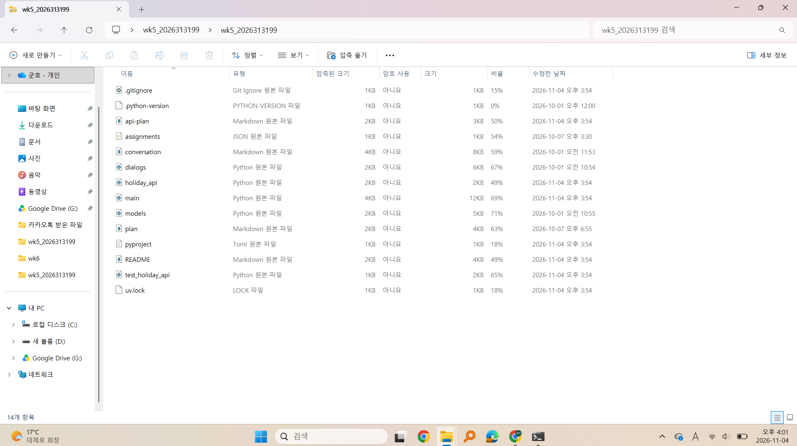

너가 시키는 대로 하면 다시 이렇게 돼

---

## ChatGPT

아, 이제 상황을 알겠습니다. 제가 같은 과정을 반복해서 안내해서 헷갈리게 했네요. 죄송합니다.

지금 사진은 **압축이 풀린 폴더가 아니라 ZIP 파일 내부**입니다. 그래서 계속 같은 화면이 나타나는 거예요.

그런데 앞에서 파일 복사를 시도했기 때문에 **이미 기존 과제 폴더에 필요한 파일이 들어갔을 가능성도 있습니다.**

### 지금은 이것만 해주세요!

1. 파일 탐색기는 그대로 두세요.
2. 아까 사용하던 PowerShell 창으로 돌아가세요.
3. 아래 명령어를 입력하세요.

```powershell
git status
```

PowerShell 위치는 다음과 같아야 합니다.

`PS C:\Users\User\Desktop\wk5_2026313199>`

**실행 결과를 사진으로 보내주세요.**

결과를 보고 파일이 이미 복사되었다면 압축 풀기 과정은 건너뛰겠습니다. 더 이상 같은 작업을 반복하지 않도록 하겠습니다.

---

## 사용자

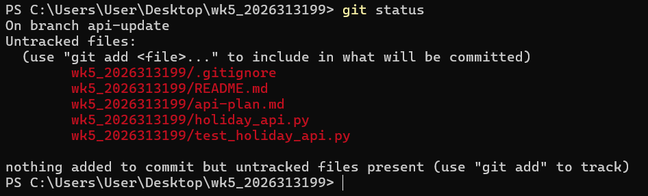

---

## ChatGPT

좋습니다! 이제 상황이 정확히 보입니다. 😊

현재 GitHub의 `api-update` 브랜치에서 다음 5개 파일이 **새 파일로 인식되고 있습니다.**

- `.gitignore`
- `README.md`
- `api-plan.md`
- `holiday_api.py`
- `test_holiday_api.py`

다만 중요한 점이 있습니다. **API를 실제 프로그램에 연결하는 `main.py`는 변경된 파일로 표시되지 않았습니다.**

따라서 지금은 파일을 다시 복사하지 말고, 기존 프로그램에 API 코드가 적용되었는지 확인하겠습니다.

### 9단계. API 적용 상태 확인

현재 PowerShell에서 아래 두 명령어를 순서대로 입력하세요.

**① GitHub가 관리하는 기존 프로그램 위치 확인**

```powershell
git ls-files "*main.py" "*pyproject.toml" "*uv.lock"
```

**② 공휴일 API가 main.py에 연결되어 있는지 확인**

```powershell
Select-String -Path ".\wk5_2026313199\main.py" -Pattern "holiday_api"
```

두 번째 명령어에서 아무것도 출력되지 않아도 괜찮습니다. 그 결과를 보고 필요한 수정을 하겠습니다.

**두 명령어의 실행 결과를 사진으로 보내주세요.**

이제 압축을 다시 풀 필요는 없습니다. 현재 있는 파일들을 이용해 이어서 진행하겠습니다.

---

## 사용자

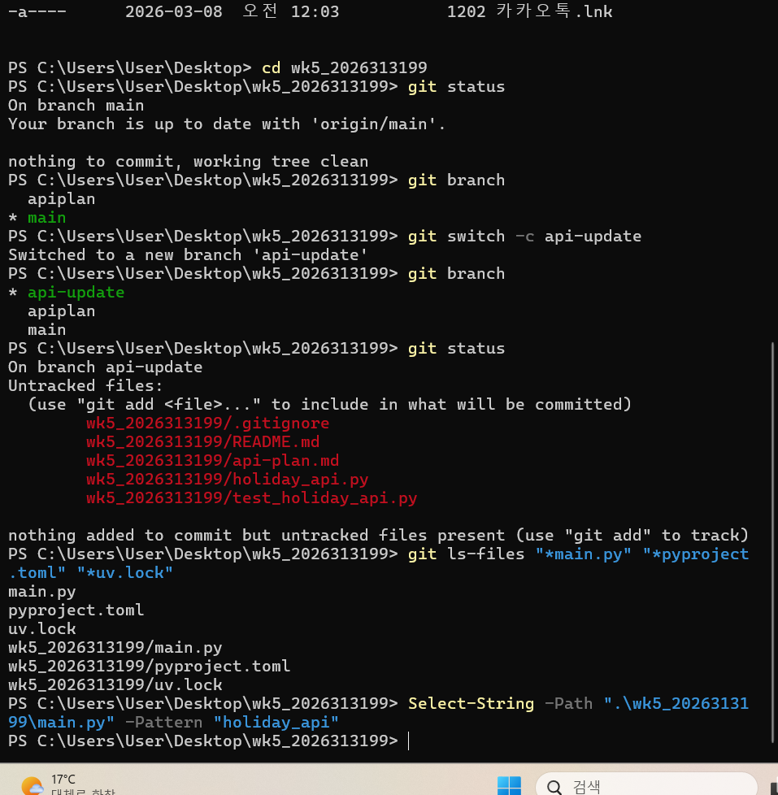

---

## ChatGPT

좋습니다! 이제 **문제의 원인을 찾았습니다.**

현재 GitHub 프로젝트에 `main.py`가 두 개 있습니다.

```text
wk5_2026313199/          ← GitHub 프로젝트 최상위
├── main.py              ← 실제 업데이트할 파일
├── pyproject.toml
├── uv.lock
└── wk5_2026313199/      ← 안쪽 폴더
    ├── main.py
    ├── holiday_api.py
    └── ...
```

지금까지 API 파일이 안쪽 폴더에 들어갔고, 실제 업데이트해야 하는 바깥쪽 `main.py`는 변경되지 않았습니다.

**이번에는 파일 탐색기를 사용하지 않고 PowerShell에서 바로 해결하겠습니다.**

### 10단계. API 업데이트 파일을 올바른 위치에 적용하기

현재 PowerShell 위치를 그대로 유지한 상태에서 아래 명령어 전체를 복사해서 실행하세요.

```powershell
if (Test-Path "$HOME\Downloads\hw_plan_api_update.zip") {
    Expand-Archive -LiteralPath "$HOME\Downloads\hw_plan_api_update.zip" -DestinationPath "." -Force
    git status
} else {
    Write-Host "다운로드 폴더에서 ZIP 파일을 찾지 못했습니다."
}
```

이 명령어는 다음 작업을 수행합니다.

1. 다운로드한 API 업데이트 ZIP 파일을 찾습니다.
2. GitHub 프로젝트의 **최상위 폴더**에 파일을 적용합니다.
3. `git status`로 변경 사항을 확인합니다.

기존 코드는 Git에 저장되어 있으므로 이전 버전을 복구할 수 있습니다.

**실행 결과를 사진으로 보내주세요.** 그러면 불필요하게 들어간 안쪽 폴더 파일을 정리하고, `uv sync`로 프로그램 실행 테스트를 진행하겠습니다.

---

## 사용자

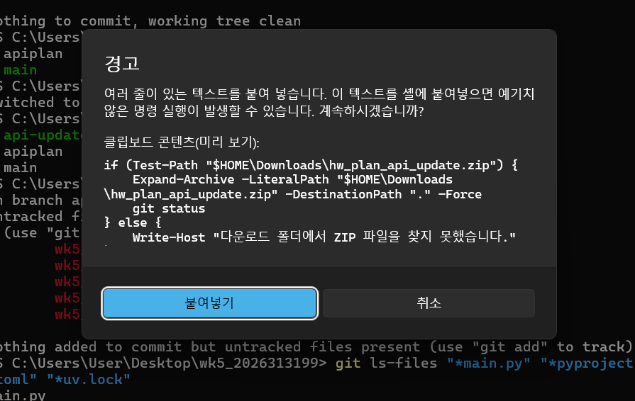

---

## ChatGPT

괜찮습니다! 오류가 아니라 **PowerShell의 보안 경고창**입니다.

여러 줄의 명령어를 한꺼번에 붙여넣으려고 해서 나타난 것입니다.

### 지금 할 일

파란색 **「붙여넣기」** 버튼을 클릭하세요.

그러면 명령어가 실행되면서 ZIP 파일을 프로젝트 폴더에 적용하고 `git status` 결과를 보여줍니다.

**실행이 끝난 화면을 보내주세요.** 결과를 확인한 다음 다음 단계로 진행하겠습니다.

---

## 사용자

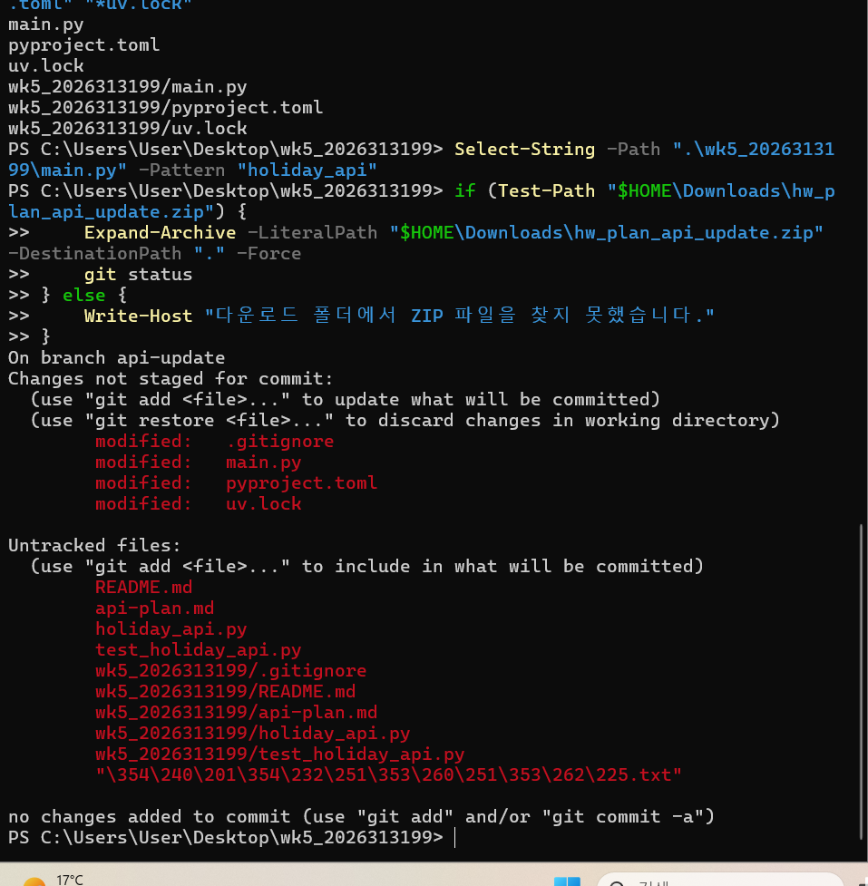

---

## ChatGPT

좋습니다! 이번에는 **API 업데이트 파일이 올바른 위치에 적용되었습니다!** 🎉

사진에서 다음 내용을 확인했습니다.

- `main.py` — 수정됨
- `pyproject.toml` — 수정됨
- `uv.lock` — 수정됨
- `holiday_api.py` — 추가됨
- `api-plan.md` — 추가됨
- `README.md` — 추가됨

현재 브랜치도 `api-update`로 정확합니다.

다만 안쪽 `wk5_2026313199` 폴더에 중복 복사된 파일이 몇 개 있습니다. 이 파일들은 나중에 안전하게 정리하고, **우선 프로그램이 정상적으로 작동하는지 확인하겠습니다.**

## 11단계. UV 실행 환경 설정하기

현재 PowerShell 위치를 변경하지 말고 다음 명령어를 입력하세요.

```powershell
uv sync
```

이 명령어는 과제에 필요한 Python 패키지들을 설치하고 실행 환경을 맞추는 역할을 합니다.

실행에 성공하면 다음으로 테스트를 진행하겠습니다.

**지금은 `uv sync`만 실행하고 결과 화면을 보내주세요.**

오류가 나더라도 직접 수정하지 말고 화면을 보여주시면 됩니다.

---

## 사용자

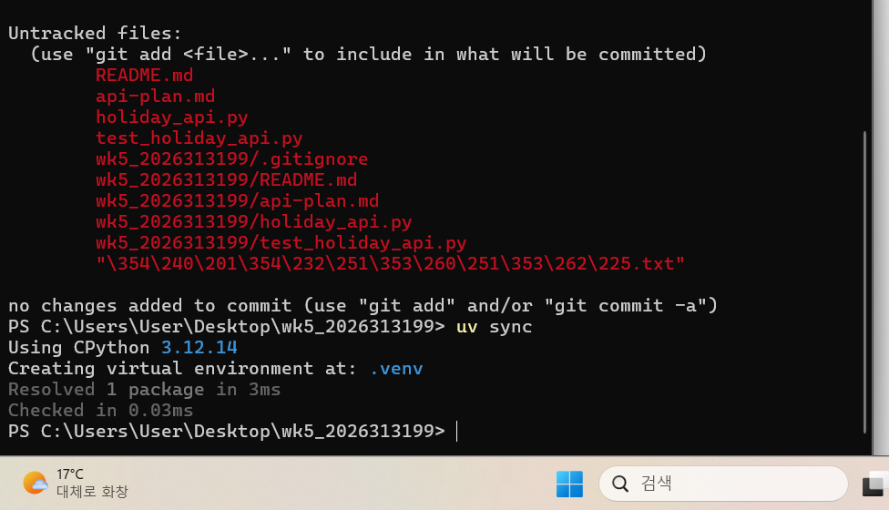

---

## ChatGPT

좋습니다! 😊 **`uv sync`가 정상적으로 완료되었습니다.**

사진을 확인하면 다음과 같습니다.

- `Using CPython 3.12.14` → Python 버전 확인 완료
- `Creating virtual environment at: .venv` → 가상환경 생성 완료
- `Resolved 1 package` → 필요한 패키지 확인 완료
- `Checked in 0.03ms` → 오류 없이 종료

이제 실제 API 기능을 테스트하겠습니다.

### 12단계. 공휴일 API 코드 테스트

PowerShell에 아래 명령어를 입력하세요.

```powershell
uv run python -m unittest -v test_holiday_api
```

이 명령어는 `test_holiday_api.py`에 작성된 테스트를 실행합니다.

정상적으로 통과하면 `OK`가 표시됩니다.

**실행 결과 화면을 보내주세요.**

테스트가 성공하면 다음으로 실제 과제 일정 관리 프로그램을 실행하여 공휴일 기능이 표시되는지 확인하겠습니다. 아직 GitHub에 커밋하지는 마세요!

---

## 사용자

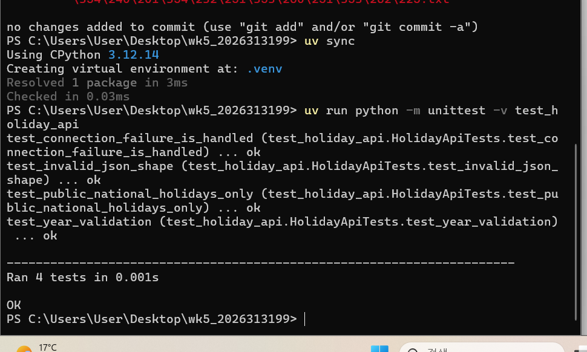

---

## ChatGPT

좋습니다! 🎉 **API 관련 테스트 4개가 모두 통과했습니다!**

사진에 다음과 같이 나와 있습니다.

```text
Ran 4 tests in 0.001s

OK
```

현재까지 확인된 사항은 다음과 같습니다.

- ✅ GitHub `api-update` 브랜치 생성 완료
- ✅ API 업데이트 파일 적용 완료
- ✅ `uv sync` 정상 완료
- ✅ API 코드 테스트 4개 통과

다만 테스트 통과가 실제 공휴일 서버 연결과 프로그램 화면의 정상 작동까지 보장하지는 않습니다.

## 13단계. 실제 프로그램 실행하기

이제 과제 일정 관리 프로그램을 직접 실행해 보겠습니다.

현재 PowerShell에서 아래 명령어를 입력하세요.

```powershell
uv run python main.py
```

정상적으로 실행되면 과제 일정 관리 프로그램 창이 나타날 것입니다.

**프로그램이 실행되면 창 전체를 캡처해서 보내주세요.**

공휴일 표시 기능이 제대로 추가되었는지 확인하고, 실제 API 연결까지 테스트하겠습니다.

그다음 불필요한 중복 파일 정리 → AI 대화 원문 추가 → README 확인 → GitHub PR 및 Merge 순서로 마무리하겠습니다.

---
## 사용자

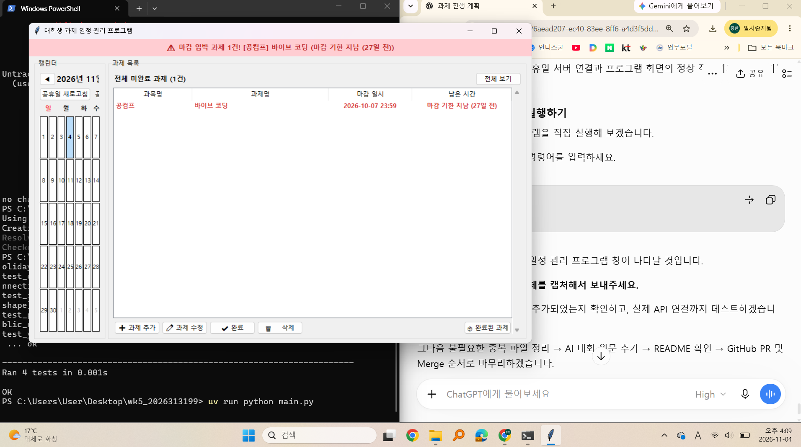

---

## ChatGPT

좋습니다! 🎉 **과제 일정 관리 프로그램이 정상적으로 실행되었습니다!**

사진을 확인해 보니 기존 과제 목록과 마감일 알림이 유지되어 있고, 새롭게 추가한 **「공휴일 새로고침」 버튼**도 보입니다.

이제 실제로 API 서버에서 공휴일 정보를 가져오는지 확인하겠습니다.

### 14단계. 공휴일 API 작동 확인하기

현재 달력이 `2026년 11월`로 표시되어 있습니다.

다음 순서대로 진행해 주세요.

1. 달력 왼쪽 위의 **◀ 버튼**을 한 번 눌러 `2026년 10월`로 이동하세요.
2. 바로 아래 **「공휴일 새로고침」** 버튼을 클릭하세요.
3. 달력에서 10월 3일(개천절)과 10월 9일(한글날)이 공휴일로 표시되는지 확인하세요.

10월은 공휴일이 있어 API 작동 여부를 확인하기 좋습니다.

**여기까지 진행한 프로그램 화면을 보내주세요.**

공휴일이 정상적으로 표시되면 실제 API 연결도 확인할 수 있습니다. 이후 중복 파일 정리와 GitHub PR 제출을 진행하겠습니다.

---

## 사용자

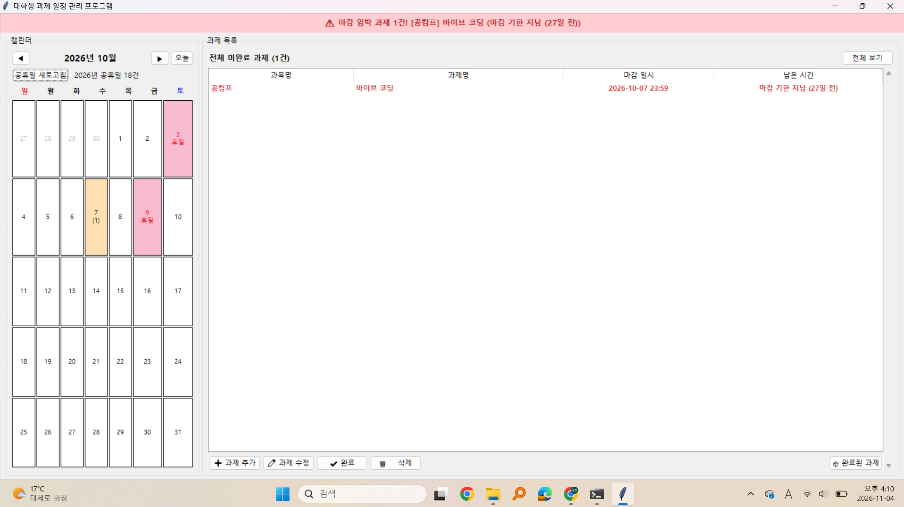

---

## ChatGPT

성공했습니다! 🎉 **공휴일 API가 실제로 정상 작동하는 것까지 확인했습니다!**

사진에서 다음 내용을 확인할 수 있습니다.

- **2026년 공휴일 18건** 조회
- 10월 3일 개천절 → 분홍색으로 `휴일` 표시
- 10월 9일 한글날 → 분홍색으로 `휴일` 표시
- 기존 과제 일정과 마감일 알림 기능도 유지

이제 과제에서 가장 중요한 **프로그램 작동과 UV 실행 테스트를 통과한 상태**입니다.

## 15단계. GitHub에 올릴 파일 선택하기

이제 불필요한 중복 파일이 GitHub에 올라가지 않도록 정리하겠습니다.

**① 먼저 실행 중인 프로그램 창을 X 버튼으로 닫으세요.**

**② PowerShell에 다음 명령어를 입력하세요.**

```powershell
git add .gitignore main.py pyproject.toml uv.lock holiday_api.py test_holiday_api.py api-plan.md README.md
```

이 명령어는 필요한 파일 8개만 Git에 등록합니다. 안쪽 폴더에 잘못 복사된 중복 파일은 포함하지 않습니다.

**③ 이어서 입력하세요.**

```powershell
git status
```

정상적으로 등록되면 `Changes to be committed` 아래에 파일들이 초록색으로 나타납니다.

아직 커밋하거나 Push하지 마세요.

**여기까지 실행한 화면을 보내주세요.**

그다음 과제 필수 조건인 AI 대화 원문을 추가하고, 불필요한 파일을 정리한 뒤 **Commit → Push → Pull Request → Merge**까지 진행하겠습니다.

---

## 사용자

파워쉘을 다시 열라는 말인가요?

---

## ChatGPT

아니요! 😊 **PowerShell을 다시 열 필요는 없습니다.**

아까 사용하던 PowerShell 창을 그대로 사용하시면 됩니다.

1. 실행 중인 **대학생 과제 일정 관리 프로그램**을 오른쪽 위 `X` 버튼으로 닫으세요.
2. 기존 **PowerShell 창**으로 돌아가세요.
3. 다음과 같은 입력창이 보이면 정상입니다.

```powershell
PS C:\Users\User\Desktop\wk5_2026313199>
```

그 상태에서 아래 명령어를 복사해서 실행하세요.

```powershell
git add .gitignore main.py pyproject.toml uv.lock holiday_api.py test_holiday_api.py api-plan.md README.md
```

이어서 입력하세요.

```powershell
git status
```

**실행 결과를 사진으로 보내주세요!** 다음 단계부터 이어서 진행하겠습니다.

---

## 사용자

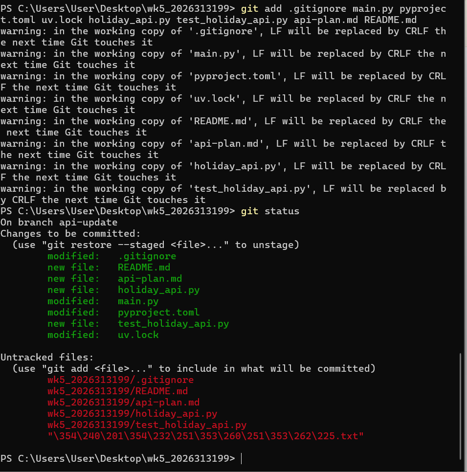

---

## ChatGPT

좋습니다! 🎉 **GitHub에 올릴 8개 파일이 정상적으로 등록되었습니다.**

사진에서 초록색으로 표시된 파일 8개가 이번 과제의 업데이트 파일입니다.

또한 위쪽의 `LF will be replaced by CRLF` 경고는 Windows에서 줄바꿈 방식을 처리하면서 나타나는 것으로, **오류가 아닙니다.**

## 16단계. 불필요한 중복 파일 정리하기

빨간색으로 표시된 파일들은 앞에서 잘못 복사한 중복 파일입니다. 이것들만 삭제하겠습니다.

**기존 과제 파일들은 삭제하지 않습니다.**

현재 PowerShell에 아래 명령어를 그대로 복사해서 실행하세요.

```powershell
Remove-Item -LiteralPath ".\wk5_2026313199\.gitignore", ".\wk5_2026313199\README.md", ".\wk5_2026313199\api-plan.md", ".\wk5_2026313199\holiday_api.py", ".\wk5_2026313199\test_holiday_api.py", ".\적용방법.txt"
```

이 명령어는 중복으로 생긴 파일 5개와 ZIP에 포함되었던 안내문만 삭제합니다.

이어서 다음 명령어를 실행하세요.

```powershell
git status
```

정상적으로 정리되면 `Untracked files` 항목이 사라지고, 초록색 파일 8개만 남을 것입니다.

**실행 결과를 보내주세요.**

그다음 과제 필수 조건인 **AI 대화 원문을 저장소에 추가**하고, 커밋과 Pull Request를 진행하겠습니다. 아직 `git commit`은 하지 마세요!

---

## 사용자

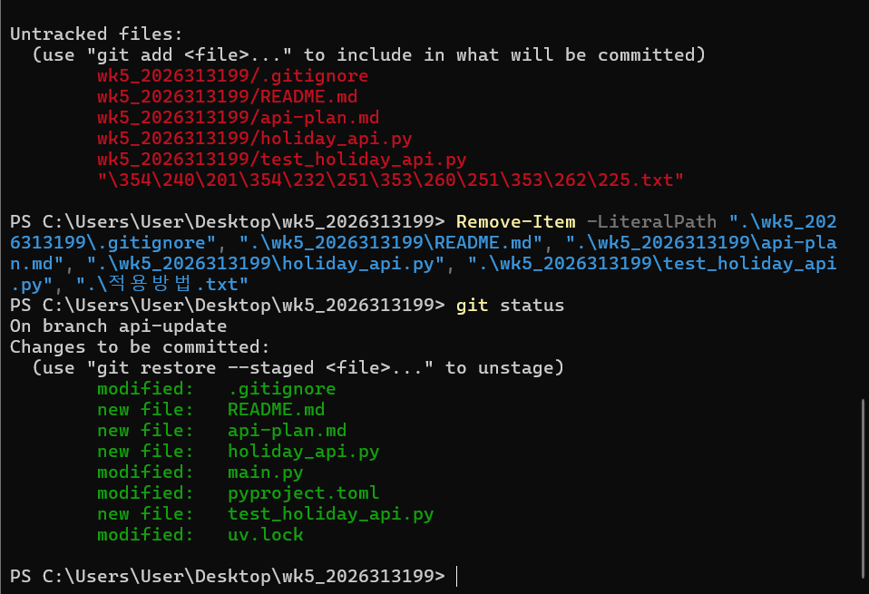

---

## ChatGPT

좋습니다! 🎉 **불필요한 중복 파일 정리가 완료되었습니다.**

사진을 확인하니 현재 상태가 아주 좋습니다.

- ✅ `api-update` 브랜치 유지
- ✅ 필요한 파일 8개 Git 등록 완료
- ✅ 중복 파일 정리 완료
- ✅ `Untracked files` 항목 사라짐

이제 GitHub에 제출하기 전 마지막 필수 조건을 처리하겠습니다.

## 17단계. AI 대화 원문 추가하기

교수님께서 **AI와 대화한 원문을 Repository에 포함**하도록 요구하셨습니다.

기존 `conversation.md`는 보존하고, 이번 API 업데이트 과정에서 나눈 대화는 `api-chat.md`로 별도 저장하겠습니다.

먼저 PowerShell에서 다음 명령어를 실행하세요.

```powershell
notepad api-chat.md
```

메모장이 열리면서 새 파일을 만들겠냐고 물으면 **「예」**를 누르세요.

이 파일에 이번 API 과제를 진행하면서 실제로 나눈 질문과 답변을 수정하지 않고 복사해 넣으면 됩니다. 요약본이 아닌 원문이어야 합니다.

**우선 메모장을 여는 것까지만 해주세요.** 그다음 대화 내용을 저장하는 방법을 안내하겠습니다.

이 단계가 끝나면 Commit → Push → Pull Request → Merge 순서로 제출을 마무리하겠습니다.

---

## 사용자

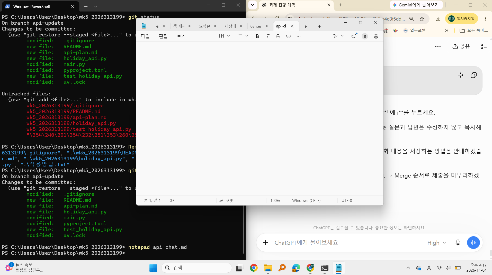

이렇게 아무것도 없는게 맞나요?

---

## ChatGPT

네, 맞습니다! 😊 **정상적으로 메모장이 열린 상태입니다.**

`api-chat.md`라는 새 파일을 만들었기 때문에 처음에는 아무 내용도 없는 것이 맞습니다.

이제 이 파일에 **이번 API 과제를 진행하면서 ChatGPT와 나눈 대화 원문**을 넣으면 됩니다.

### 18단계. 대화 내용 복사하기

1. 오른쪽에 열려 있는 ChatGPT 화면으로 이동하세요.
2. 이번 과제를 시작한 첫 질문부터 지금까지의 대화 내용을 복사하세요.
3. 다시 메모장으로 돌아가 `Ctrl + V`를 눌러 붙여넣으세요.
4. `Ctrl + S`를 눌러 저장하세요.

**주의:** 교수님이 대화 원문을 요구하셨으므로 질문과 답변을 임의로 수정하거나 요약하지 않는 것이 좋습니다.

대화가 길어 한 번에 복사하기 어렵다면 ChatGPT의 공유 또는 내보내기 기능을 이용할 수도 있습니다.

우선 대화를 붙여넣고 저장한 다음 **"저장했어"**라고 알려주세요.

그러면 `api-chat.md`를 Git에 추가하고, Commit → Push → Pull Request → Merge까지 진행하겠습니다.

---

## 사용자

어떻게 하라는건지 잘 모르겠어

---

## ChatGPT

괜찮아요! 제가 너무 복잡하게 설명했네요. 😊

지금 해야 하는 것은 **ChatGPT에서 저와 나눈 대화를 복사해서 메모장에 저장하는 것**입니다. 교수님이 AI 대화 원문을 제출하라고 하셨기 때문이에요.

한 단계씩 해봅시다.

### 1단계. ChatGPT 대화 복사하기

1. 지금 열려 있는 **메모장은 그대로 두세요.**
2. 오른쪽에 있는 **ChatGPT 화면**을 클릭하세요.
3. 제 답변 아래에 마우스를 가져가면 복사 모양의 **복사 버튼**이 나타납니다.
4. 그 버튼을 누르면 해당 답변이 복사됩니다.

### 2단계. 메모장에 붙여넣기

1. 아까 열었던 빈 메모장을 클릭하세요.
2. 키보드에서 `Ctrl + V`를 누르세요.
3. 복사했던 답변이 메모장에 나타나면 성공입니다.

이 방법으로 질문과 답변을 순서대로 저장할 수 있습니다. 본인이 작성한 질문은 마우스로 문장을 드래그한 뒤 `Ctrl + C`로 복사하면 됩니다.

**우선 제 답변 하나만 복사해서 메모장에 붙여넣어 보세요.**

성공하면 알려주세요. 그다음 대화 전체를 정리해 저장하는 방법을 이어서 안내하겠습니다.

---

## 사용자

그러면 하나하나 다 하는거야? 아니면 한번에 하는거야8?

---

## ChatGPT

**한 번에 복사하면 됩니다!** 😊 하나하나 복사할 필요는 없어요.

제가 아까 하나씩 복사하라고 한 것은 연습용이었습니다.

### 한 번에 복사하는 방법

1. 지금 ChatGPT 대화 화면에서 **맨 위의 첫 질문까지 스크롤**하세요.
2. 채팅 입력창이 아닌 **대화 내용의 빈 공간**을 클릭하세요.
3. `Ctrl + A`를 눌러 전체 선택하세요.
4. `Ctrl + C`를 눌러 복사하세요.
5. 아까 열었던 빈 메모장으로 돌아가 `Ctrl + V`를 누르세요.
6. `Ctrl + S`를 눌러 저장하세요.

단, 브라우저에 따라 화면에 표시된 대화 일부만 복사되거나 메뉴까지 함께 복사될 수 있습니다.

**우선 `Ctrl + A`를 눌러보세요.** 화면이 어떻게 변하는지 알려주시면 다음 단계로 안내하겠습니다.

---

## 사용자

그러면 너가 대화내용을 요약없이 마크다운으로 저장해주면 안돼?

---

## ChatGPT

네! 제가 대신 만들어 드렸습니다. 😊

**이번 API 과제를 시작한 첫 질문부터 지금까지의 대화를 요약하지 않고 마크다운 파일로 정리했습니다.** 보내주신 스크린샷 20장도 함께 포함했습니다.

**[대화 원문 + 스크린샷 전체 다운로드](api_chat_full_with_images.zip)**

ZIP · 2.6MB · 마크다운 파일과 사진 20장

**[api-chat.md 파일만 다운로드](api-chat.md)**

Markdown · 약 38KB · 이미지 파일 별도

참고로 ChatGPT의 공식 대화 내보내기 파일은 아니며, 이 대화에서 확인할 수 있는 내용을 순서대로 옮긴 기록입니다.

### 이제 할 일

1. 위의 **첫 번째 ZIP 파일**을 다운로드하고 압축을 푸세요.
2. 압축을 푼 폴더에 있는 `api-chat.md`와 `api-chat-images` 폴더를 복사하세요.
3. 바탕화면의 `wk5_2026313199` 폴더에 붙여넣으세요. 기존에 열어둔 빈 메모장은 저장하지 않고 닫아도 됩니다.

이렇게 하면 교수님이 요구한 AI 대화 기록을 GitHub에 추가할 준비가 됩니다.

**복사가 끝나면 "복사했어"라고 알려주세요.** 그다음 GitHub Commit → Push → Pull Request → Merge까지 이어서 진행하겠습니다.

---

## 사용자

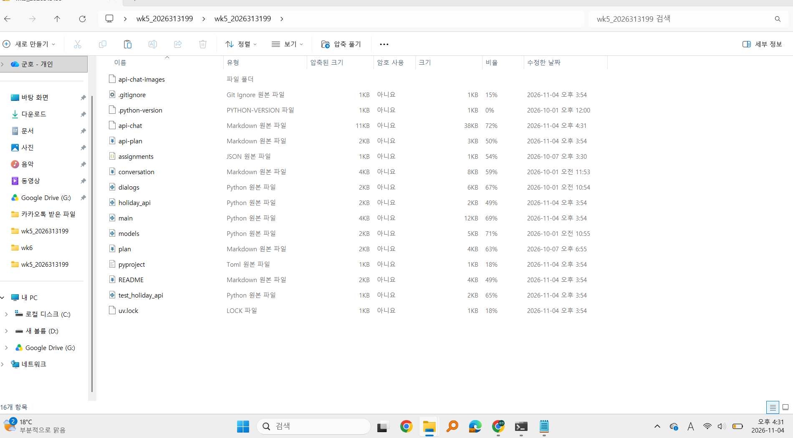

---

## ChatGPT

사진 확인했습니다! `api-chat.md` 파일과 `api-chat-images` 폴더가 모두 보입니다. 👍

다만 화면 위에 **「압축 풀기」**, **「압축된 크기」**가 있는 것으로 보아 아직 ZIP 파일 내부입니다. 실제 GitHub 과제 폴더에 들어갔는지는 확인해야 합니다.

이번에는 파일 탐색기를 사용하지 않고 **PowerShell로 정확한 위치에 복사**하겠습니다.

### 19단계. AI 대화 파일 넣기

기존 PowerShell 창으로 돌아가서 아래 명령어를 하나씩 실행하세요.

**① 대화 파일 압축 풀기**

```powershell
Expand-Archive -Path "$HOME\Downloads\api_chat_full_with_images.zip" -DestinationPath "$env:TEMP\api-chat-extracted" -Force
```

**② 실제 GitHub 과제 폴더에 복사하기**

```powershell
Copy-Item "$env:TEMP\api-chat-extracted\api-chat.md" "." -Force
```

```powershell
Copy-Item "$env:TEMP\api-chat-extracted\api-chat-images" "." -Recurse -Force
```

**③ 복사 결과 확인**

```powershell
git status
```

현재 PowerShell 위치는 반드시 아래와 같아야 합니다.

`PS C:\Users\User\Desktop\wk5_2026313199>`

정상적으로 복사되면 `Untracked files`에 `api-chat.md`와 `api-chat-images/`가 표시될 것입니다.

**여기까지 실행한 화면을 보내주세요.** 확인 후 GitHub 커밋과 PR 제출을 진행하겠습니다.

---

## 사용자

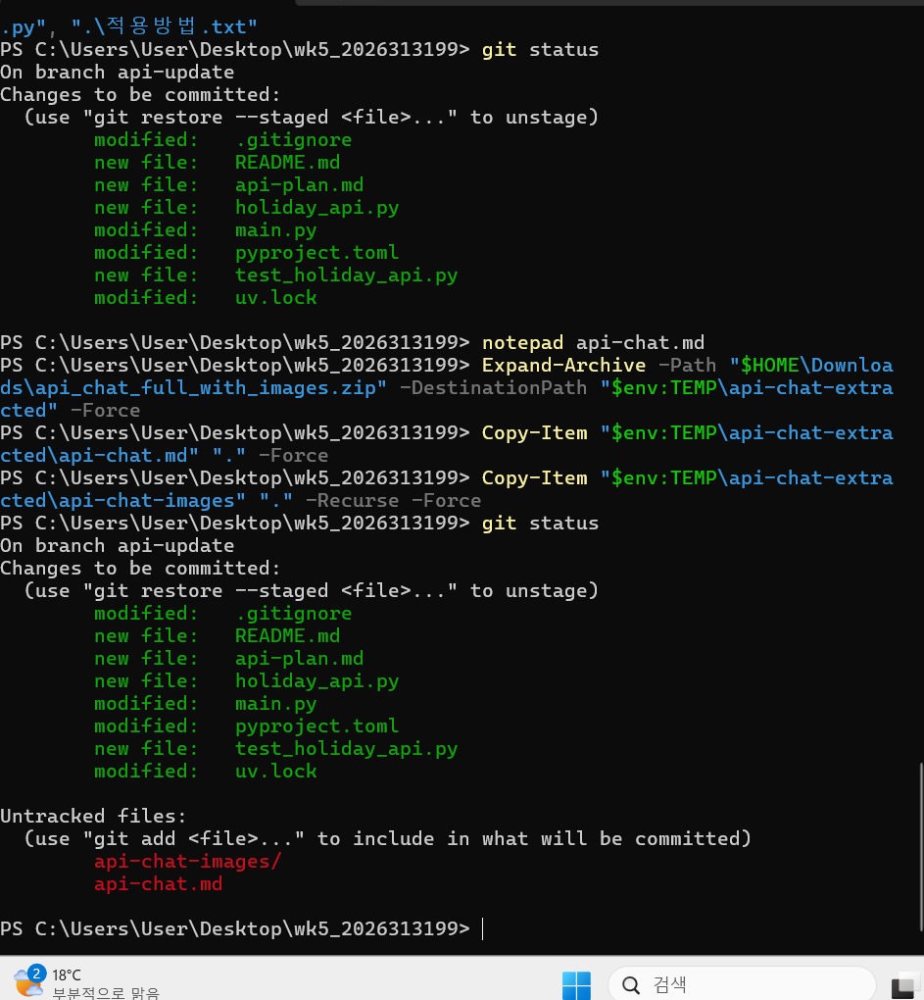

---

## ChatGPT

좋습니다! 🎉 **AI 대화 원문과 스크린샷이 정상적으로 복사되었습니다.**

사진에서 다음 두 항목을 확인했습니다.

- `api-chat.md` — AI 대화 원문
- `api-chat-images/` — 대화 중 사용한 스크린샷

기존에 등록한 프로그램 파일 8개도 그대로 유지되어 있습니다.

## 20단계. AI 대화 파일 Git에 추가하기

현재 PowerShell에서 아래 명령어를 입력하세요.

```powershell
git add api-chat.md api-chat-images/
```

이어서 입력하세요.

```powershell
git status
```

정상적으로 등록되면 `api-chat.md`와 `api-chat-images/` 안의 이미지들도 **초록색**으로 표시됩니다.

참고로 GitHub에 올리면 대화와 스크린샷이 공개될 수 있으니 개인정보나 API 키가 포함되어 있지 않은지도 확인해야 합니다.

**여기까지 실행한 화면을 보내주세요!**

그다음 바로 GitHub에 **Commit → Push → Pull Request → Merge**를 진행하겠습니다. 이제 제출까지 얼마 남지 않았습니다!

---

## 사용자

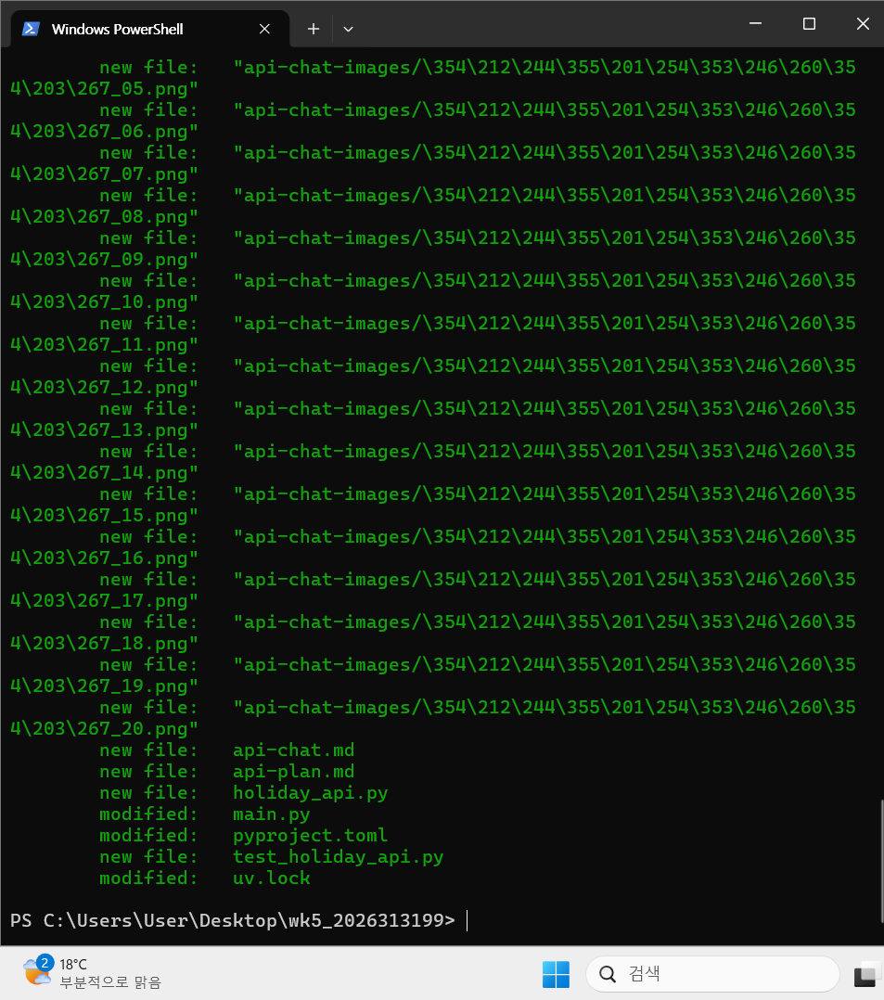

---

## ChatGPT

좋습니다! 🎉 **GitHub에 제출할 파일들이 모두 정상적으로 등록되었습니다.**

사진을 확인하니 다음 항목들이 초록색으로 표시되어 있습니다.

- API 업데이트 프로그램 파일
- `api-plan.md` 기획안
- `README.md` 코드 설명
- `api-chat.md` AI 대화 기록
- `api-chat-images/` 스크린샷 20장
- UV 실행 환경 파일

파일 이름이 `\354\212...`처럼 보이는 것은 Git이 한글 파일명을 표시하는 방식이므로 오류가 아닙니다.

## 21단계. Git Commit 하기

이제 변경된 내용을 `api-update` 브랜치에 저장하겠습니다.

단, GitHub 저장소가 공개 상태라면 스크린샷에 포함된 개인정보도 공개될 수 있으니 확인해 주세요.

PowerShell에 아래 명령어를 입력하세요.

```powershell
git commit -m "Add public holiday API integration"
```

정상적으로 완료되면 다음과 비슷한 메시지가 나타납니다.

```text
[api-update xxxxxxx] Add public holiday API integration
XX files changed
```

**여기까지 실행한 화면을 보내주세요!**

그다음에는 `git push`로 GitHub에 업로드하고, Pull Request를 만들어 `main` 브랜치에 병합하겠습니다.

---

## 사용자

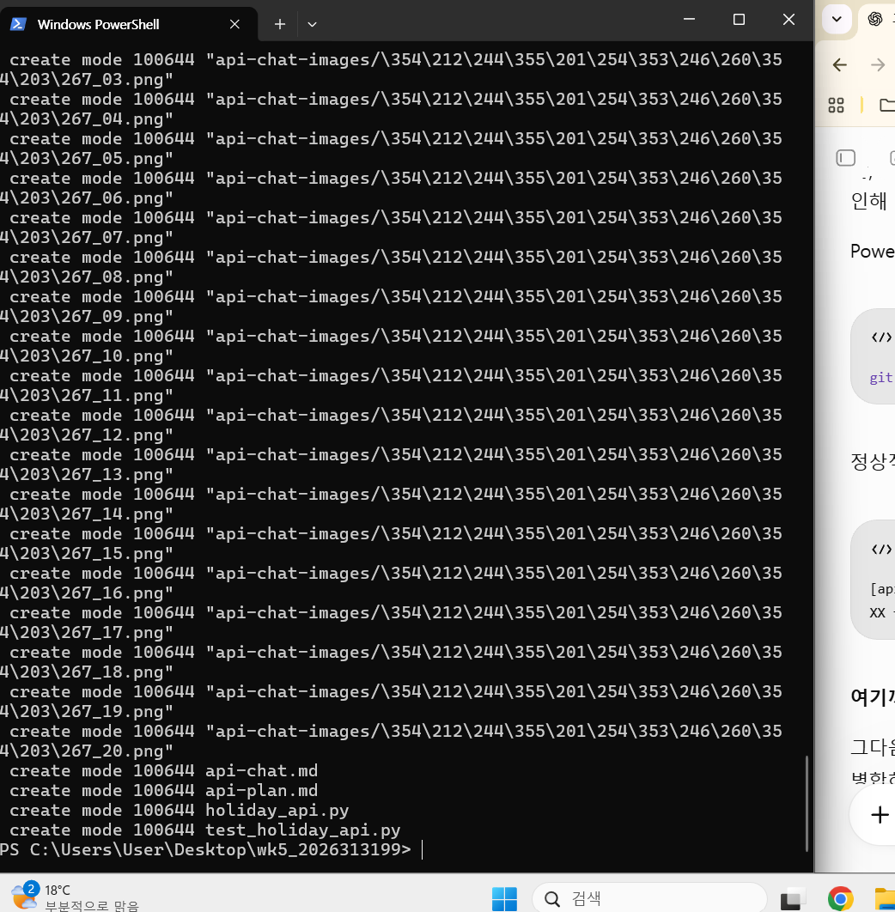

---

## ChatGPT

좋습니다! 🎉 **Git Commit이 정상적으로 완료되었습니다.**

사진에서 `create mode 100644` 메시지가 나오고, 마지막에 PowerShell 입력창으로 돌아온 것을 확인했습니다. 오류는 없습니다.

이제 GitHub에 업로드하겠습니다.

### 22단계. GitHub에 Push 하기

현재 PowerShell에서 아래 명령어를 입력하세요.

```powershell
git push -u origin api-update
```

이 명령어는 지금까지 작업한 `api-update` 브랜치를 GitHub 원격 저장소에 업로드합니다.

정상적으로 완료되면 다음과 비슷한 메시지가 나타납니다.

```text
[new branch]      api-update -> api-update
branch 'api-update' set up to track 'origin/api-update'
```

**여기까지 실행한 화면을 보내주세요!**

다음 단계에서 GitHub 웹사이트로 이동해 **Pull Request(PR)를 만들고 `main` 브랜치에 Merge**하겠습니다. 이제 제출 직전입니다!

---

## 사용자

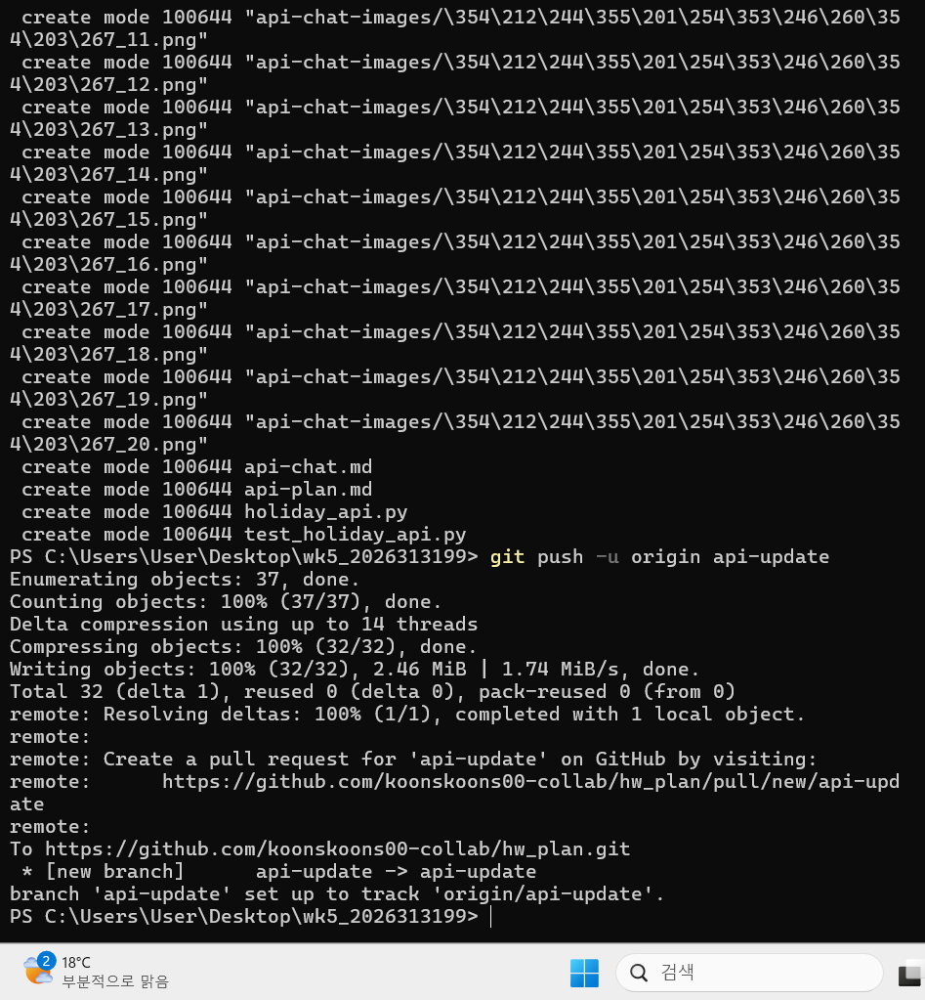

---

## ChatGPT

좋습니다! 🎉 **GitHub Push가 정상적으로 완료되었습니다!**

사진에서 다음 메시지를 확인했습니다.

```text
[new branch]      api-update -> api-update
branch 'api-update' set up to track 'origin/api-update'.
```

이제 마지막 단계인 **Pull Request(PR) 생성 → main 브랜치에 Merge**만 남았습니다.

## 23단계. Pull Request 만들기

아래 링크를 클릭하세요.

**GitHub Pull Request 생성**

[api-update → main PR 만들기](https://github.com/koonskoons00-collab/hw_plan/compare/main...api-update?expand=1)

GitHub 화면이 열리면 다음 내용을 확인하세요.

- **base:** `main`
- **compare:** `api-update`

그다음 초록색 **Create pull request** 버튼을 누르세요.

### PR 제목과 설명

제목은 다음과 같이 작성하면 됩니다.

**PR 제목**

`Add public holiday API to assignment planner`

설명은 아래 내용을 복사하세요.

```markdown
## 변경 사항
- Nager.Date 공휴일 API 연동
- 달력에 공휴일 표시 기능 추가
- 공휴일 새로고침 기능 추가
- 기존 과제 관리 및 마감일 알림 기능 유지
- API 기획안, README 및 AI 대화 원문 추가

## 테스트
- `uv sync` 실행 성공
- 단위 테스트 4개 통과
- `uv run python main.py` 실행 성공
- 2026년 10월 공휴일 표시 확인
```

**PR을 생성한 화면을 보내주세요.** 확인한 다음 `Merge pull request` 버튼을 눌러 과제를 마무리하겠습니다.

아직은 `main`에 병합되지 않았으므로 **Merge까지 완료해야 제출 조건을 충족합니다.**

---

## 사용자

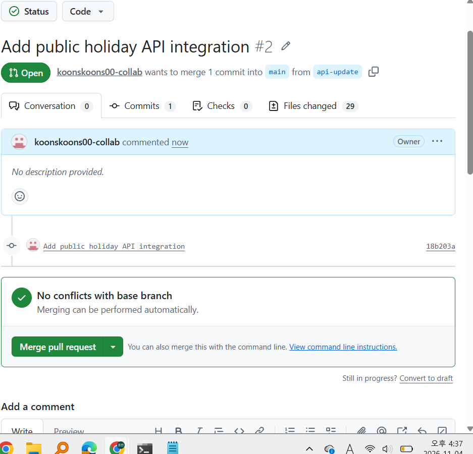

제목과 설명 어디에 적어

---

## ChatGPT

지금 화면을 보니 **Pull Request가 이미 정상적으로 생성되었습니다!** 🎉

제목도 `Add public holiday API integration`으로 잘 작성되어 있습니다.

다만 설명 부분에 `No description provided.`라고 표시되어 있으므로 설명만 추가하면 됩니다.

### 1단계. PR 설명 추가하기

1. 화면의 `No description provided.` 오른쪽에 마우스를 올려보세요.
2. 나타나는 **점 세 개(···)** 메뉴를 클릭하세요.
3. **Edit(수정)**을 선택하세요.
4. 아래 내용을 복사해서 붙여넣으세요.

**PR 설명**

```markdown
## 변경 사항
- Nager.Date 공휴일 API 연동
- 달력에 공휴일 표시 및 새로고침 기능 추가
- 기존 과제 관리 기능 유지
- API 기획안, README, AI 대화 원문 추가

## 테스트
- uv sync 성공
- 단위 테스트 4개 통과
- 프로그램 실행 및 공휴일 표시 확인
```

5. **Save(저장)** 버튼을 누르세요.

### 2단계. main에 병합하기

사진 아래쪽에 초록색 **Merge pull request** 버튼이 보입니다.

설명을 저장한 후 다음 순서로 누르세요.

1. `Merge pull request`
2. `Confirm merge`

그러면 `api-update` 브랜치의 변경 사항이 `main` 브랜치에 반영됩니다.

**Merge까지 완료한 화면을 보내주세요.** 마지막으로 과제 제출용 GitHub URL을 확인하겠습니다.

---

## 사용자

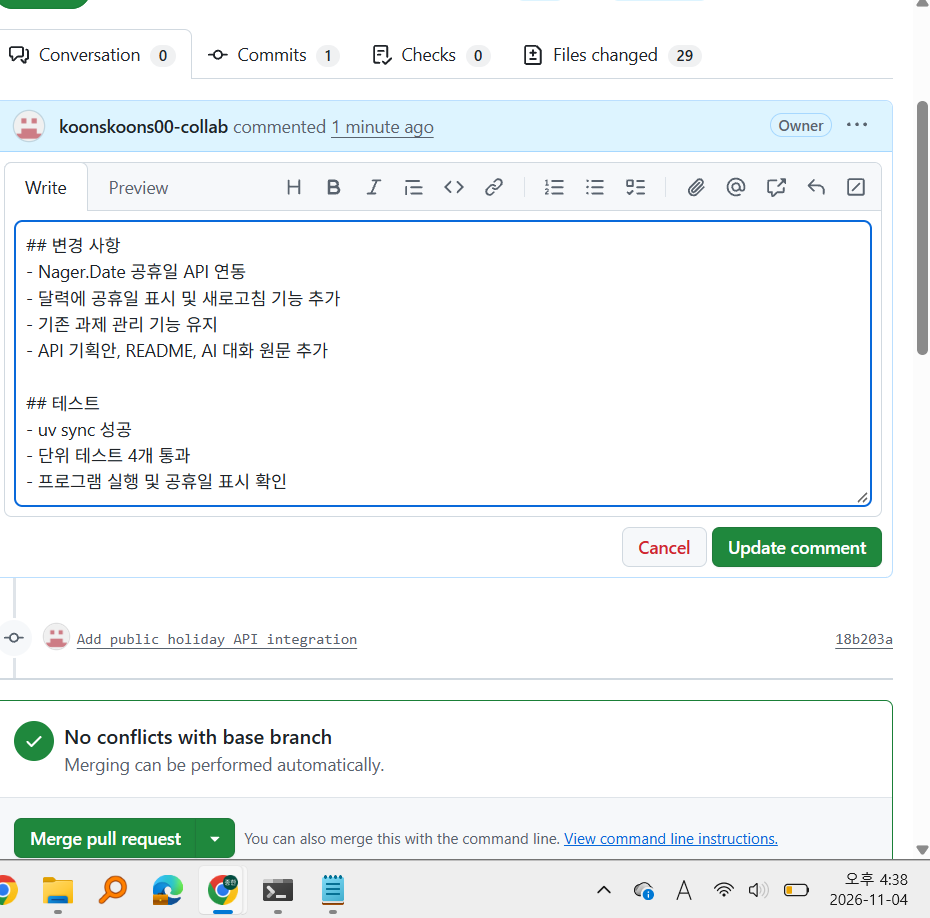

---

## ChatGPT

네! 사진을 확인했습니다. 😊 **PR 설명을 정확하게 입력하셨습니다.**

이제 버튼만 누르면 됩니다.

### 1단계. 설명 저장하기

현재 화면 오른쪽에 있는 초록색 **`Update comment`** 버튼을 클릭하세요.

그러면 작성한 설명이 저장됩니다.

### 2단계. Pull Request 병합하기

설명을 저장한 후 화면 아래쪽에 있는 초록색 **`Merge pull request`** 버튼을 누르세요.

그다음 나타나는 **`Confirm merge`** 버튼까지 눌러주세요.

이렇게 하면 `api-update` 브랜치의 코드가 `main` 브랜치에 합쳐집니다.

**병합이 완료된 화면을 보내주세요!**

그다음 교수님께 제출할 GitHub 주소를 최종 확인하겠습니다.

---

## 사용자

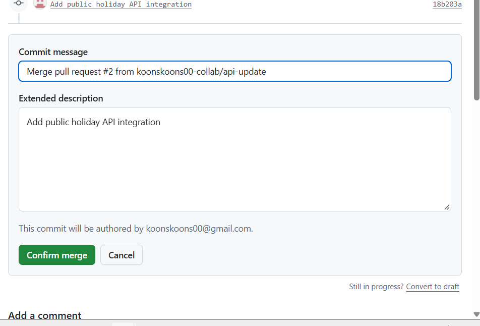

---

## ChatGPT

좋습니다! 🎉 **이제 마지막 버튼만 누르면 됩니다!**

현재 화면은 Pull Request를 `main` 브랜치에 병합하기 직전입니다.

### 지금 할 일

1. **Commit message**는 현재 내용 그대로 두세요.
2. **Extended description**도 수정하지 않아도 됩니다.
3. 왼쪽 아래 초록색 **`Confirm merge`** 버튼을 클릭하세요.

정상적으로 병합되면 GitHub에 보라색 **`Merged`** 표시가 나타납니다.

**`Confirm merge`를 누른 다음 화면을 보내주세요.**

그 화면까지 확인하면 교수님께 제출할 GitHub URL을 알려드리겠습니다!

---

## 사용자

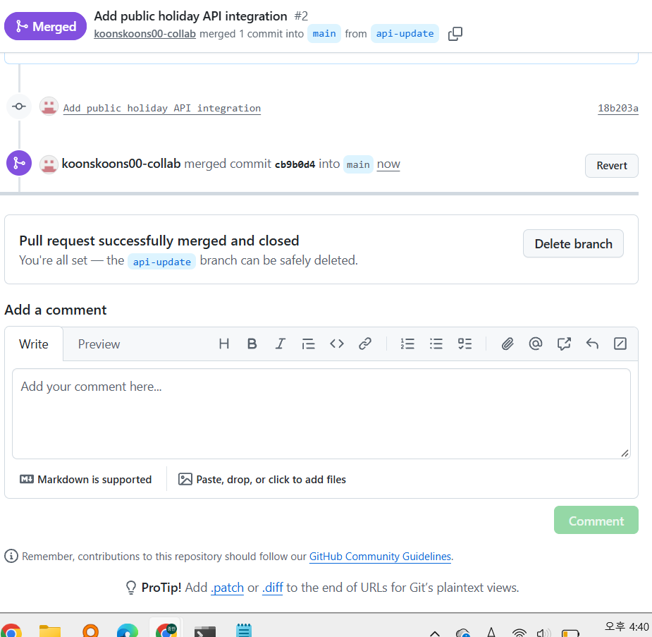

---

## ChatGPT

**제출 준비 완료**

축하합니다! 🎉 **GitHub Pull Request 병합이 정상적으로 완료되었습니다!**

사진에서 보라색 `Merged` 표시와 `Pull request successfully merged and closed` 메시지를 확인했습니다.

## 최종 제출 정보

**GitHub Repository**

iCampus에 제출할 주소

`https://github.com/koonskoons00-collab/hw_plan`

**Pull Request #2** — Merged

[완료된 Pull Request 확인](https://github.com/koonskoons00-collab/hw_plan/pull/2)

## 과제 평가 항목 확인

| 평가 항목 | 현재 상태 |
|---|---|
| 기획대로 작동하는가 (6점) | 프로그램 및 공휴일 API 작동 확인 |
| 코드 재현 가능성 (6점) | `uv sync`, 테스트 통과 |
| GitHub 관리 (4점) | 브랜치, PR, Merge 완료 |
| 코드 이해 및 README (4점) | README 작성 및 포함 |

실제 점수는 교수님의 코드 검토와 채점 기준에 따라 결정됩니다.

## 이제 iCampus에 제출하세요!

제출할 내용은 다음과 같습니다.

```text
GitHub Repository URL:
https://github.com/koonskoons00-collab/hw_plan

Pull Request:
https://github.com/koonskoons00-collab/hw_plan/pull/2

기존 대학생 과제 일정 관리 프로그램에 Nager.Date 공휴일 API를 연동하여 달력에 공휴일을 표시하고 새로고침할 수 있도록 업데이트하였습니다. 별도의 api-update 브랜치에서 작업하였으며, Pull Request를 통해 main 브랜치에 병합하였습니다.

API Key는 필요하지 않습니다.
```

**이제 GitHub에서 `Delete branch` 버튼은 누르지 않아도 됩니다.** 그대로 두어도 제출에는 문제가 없습니다.

남은 것은 iCampus에 위 저장소 URL을 제출하는 것입니다. 기한은 **오늘 11월 4일(수) 자정**입니다.

---

## 사용자

다음 사항을 참고하시길 바랍니다.

- 기획안을 별도 api-plan.md 파일로 추가해서 repository에 업로드합니다.

- API에 Key가 필요한 경우 `.env`파일에 두고, README에 어떤 형식으로 키를 넣는지 설명합니다. 키는 별도로 icampus로 제출합니다.

- 모든 코드는 UV로 동작 환경의 재현이 가능해야 합니다.

- AI와 대화 내용 원문도 repository에 포함합니다.

- 코드 전반에 대한 설명은 README에 작성하되 3페이지 이내로 작성합니다. 다 한건가요?

---

## ChatGPT

네! 지금까지 진행한 내용과 GitHub 병합 화면을 기준으로 보면 **과제의 핵심 요구사항은 거의 모두 완료되었습니다.** 🎉

다만 제출 전에 **두 가지를 확인·수정하면 더 좋겠습니다.**

## 과제 요구사항 최종 점검

| 교수님 요구사항 | 확인 결과 |
|---|---|
| `api-plan.md` 기획안 추가 | 완료 |
| API Key는 `.env`에 저장 | 키가 필요 없는 API 사용 |
| UV로 실행 환경 재현 | `uv sync` 성공 |
| AI 대화 원문 포함 | 파일은 있지만 일부 대화 누락 |
| README 3페이지 이내 작성 | 분량 및 내용 적절 |

추가로 **`api-update` 브랜치 → PR #2 → `main` 병합**도 성공했습니다.

---

## 사용자

일부 누락이 제출 이후 저희의 대화 말하는 건가요?

---

## ChatGPT

네, 맞습니다! 정확히 이해하셨어요.

제가 실제 `api-chat.md` 파일을 확인해 보니, **제가 대화 기록 파일을 만들어드렸던 시점까지만 저장되어 있습니다.**

마지막으로 저장된 질문은 다음과 같습니다.

> 그러면 너가 대화내용을 요약없이 마크다운으로 저장해주면 안돼?

따라서 그 이후에 나눈 **GitHub Commit, Push, Pull Request, Merge 과정에 관한 대화**는 포함되어 있지 않습니다.

다만 교수님이 요구한 것은 API 개발 과정의 AI 대화 원문이므로, 현재 파일에도 주요 개발 과정이 담겨 있습니다.

**그래도 가장 확실한 방법은 이후 대화까지 추가하는 것입니다.** 이미 제출한 파일을 처음부터 다시 만들 필요는 없고, `api-chat.md`만 보완하여 GitHub에 추가 커밋하면 됩니다.

원하시면 누락된 부분을 제가 마크다운 파일로 만들어드리고, 기존 GitHub 파일에 추가하는 방법까지 안내하겠습니다.

---

## 사용자

근데 그러면 대화 파일이 두개가 생겨서 감점 안당하나요?

---

## ChatGPT

아니요! **대화 파일이 두 개 있다고 해서 반드시 감점되는 것은 아닙니다.** 다만 교수님이 GitHub 파일 관리를 평가하므로 불필요한 중복 파일은 피하는 것이 좋습니다.

현재 프로젝트에는 다음 파일들이 있습니다.

- `conversation.md` : 기존 5주차 프로그램을 만들 때의 AI 대화 기록
- `api-chat.md` : 이번 API 업데이트 과제의 AI 대화 기록

**이 두 파일은 서로 다른 작업을 기록하므로 그대로 유지하는 것이 좋습니다.**

그리고 이번에 누락된 대화는 새로운 파일을 만들지 않고 **기존 `api-chat.md` 맨 아래에 추가**하면 됩니다.

즉, 최종적으로 대화 파일은 지금처럼 2개만 유지됩니다.

제 추천은 기존 `conversation.md`는 그대로 두고, `api-chat.md`만 보완하는 것입니다. 이렇게 하면 과제별 대화 기록이 구분되어 GitHub 관리 측면에서도 깔끔합니다.

다만 정확한 감점 여부는 교수님의 판단에 달려 있습니다.

---

## 사용자

알겠습니다 진행하시죠

---
